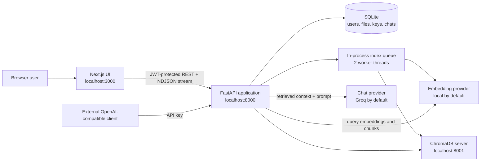
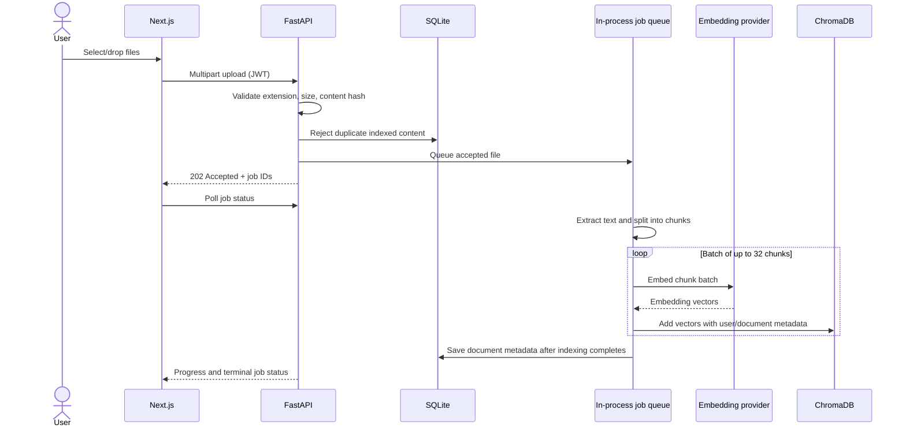

# Architecture: High-Level Design (HLD)

## 1. Purpose and scope

This document describes system-level structure and the primary runtime flows for the current local-first RAG Knowledge Base application. It is an architectural overview, not a deployment guarantee or production-readiness claim.

## 2. Context and components



### Frontend

Next.js App Router pages implement login/register, dashboard, document upload, persistent chat, API keys, Vector DB management, and admin functions. Browser code calls the FastAPI service directly. A shared API client attaches the JWT and redirects unauthorized sessions to login.

### FastAPI backend

The backend owns authentication, authorization, metadata persistence, parsers, upload job submission/status, RAG orchestration, chat persistence, external API key validation, and Chroma administration. Routers are grouped under `backend/app/routers/`.

### SQLite

SQLite is the source of truth for user accounts and roles, document metadata, API key hashes, conversations, and messages. It does not store original uploaded files.

### ChromaDB

In the default `CHROMA_MODE=server`, a separately managed Chroma process persists vectors under `backend/data/chroma` and serves the backend over localhost:8001. `CHROMA_MODE=embedded` is also supported. Collections are named for embedding provider and model; each vector carries user/document metadata.

### AI providers

Embeddings and answer generation are independent provider interfaces. Local ONNX embeddings are the default; Groq is the default answer model. API-compatible provider options allow separate models, API keys, and base URLs.

## 3. Key system flows

### Document upload and indexing



Transport progress comes from browser XHR. Indexing progress comes from polling in-memory job state. Cancellation is checked between embedding batches; cleanup deletes any chunks already added for the document.

### Question answering

```mermaid
sequenceDiagram
    actor U as User
    participant UI as Chat page
    participant API as FastAPI
    participant DB as SQLite
    participant E as Embedding provider
    participant C as ChromaDB
    participant L as Chat LLM

    U->>UI: Ask question in conversation
    UI->>API: POST message (JWT)
    API->>DB: Verify conversation owner; load recent messages
    API->>E: Embed question
    E-->>API: Query vector
    API->>C: Similarity search filtered by user_id
    C-->>API: Top-k text chunks and distances
    API->>L: Prompt + context + recent history
    L-->>UI: Stream tokens and source events
    API->>DB: Persist assistant response and source metadata
```

### OpenAI-compatible API

An API key authenticates the user's account; the same retrieval filter ensures the request only searches that account's documents. The API returns an OpenAI-shaped completion or server-sent event stream. The regular dashboard chat uses JWT and newline-delimited JSON events.

## 4. Trust boundaries

- Browser to API: JWT for dashboard routes; generated API key for external RAG endpoints.
- Backend to Chroma: localhost HTTP by default, without Chroma authentication configured.
- Backend to AI provider: provider API key over HTTPS for hosted providers; local embedding inference requires no API key.
- SQLite and Chroma data are local files and rely on host access controls.

## 5. Availability and scaling characteristics

- SQLite and local Chroma persist across app restarts when the same data directory is retained.
- Upload job state is in process memory and does not survive backend restart. A restarted worker can leave orphaned vector chunks if interruption occurs between vector writes and metadata commit.
- The backend runs with one process in the provided script. Multiple backend workers would not share in-memory job state and are not a supported job-coordination configuration.
- Local Chroma is suitable for development/single-host use. Production deployment requires deliberate network access controls, backups, durable job orchestration, and operational monitoring.

## 6. Related design

See [LLD](LLD.md) for module responsibilities, tables, and lifecycle details; [Features](../product/features.md) for the user-facing catalog; and [Security and operations](../security/operations.md) for risks and operational guidance.
