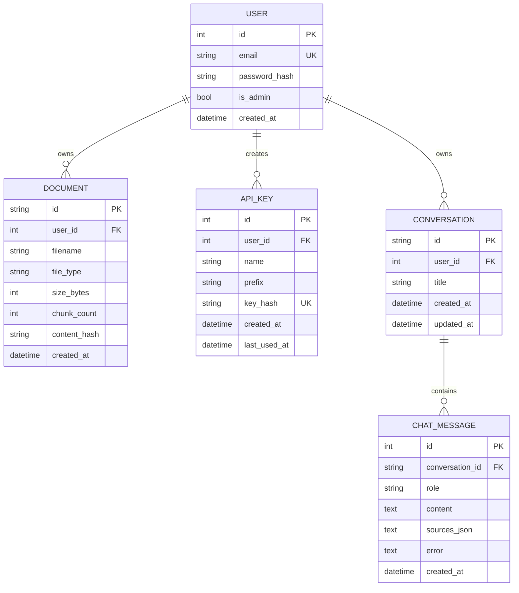
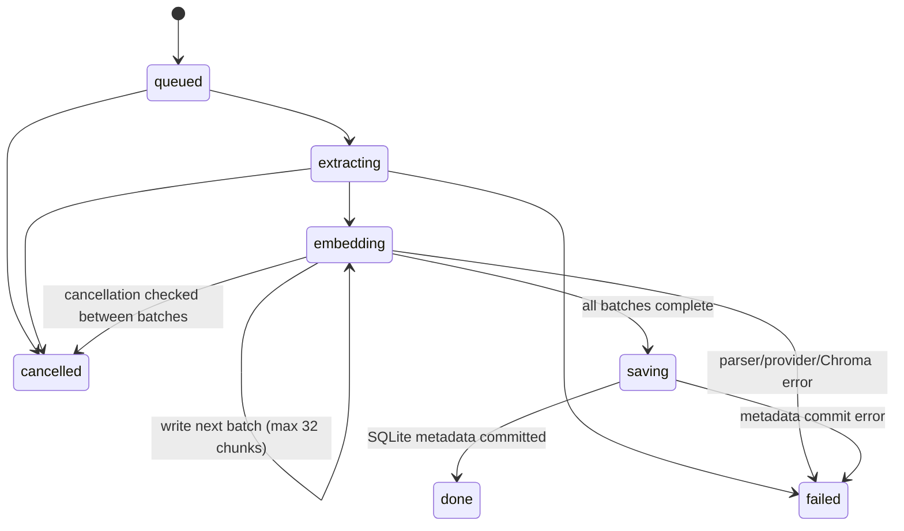

# Architecture: Low-Level Design (LLD)

## 1. Backend module map

| Module | Responsibility |
|---|---|
| `app/main.py` | FastAPI app, CORS, router registration, database startup, Chroma health endpoint. |
| `app/config.py` | Environment-backed settings and data-directory setup. |
| `app/db.py` | SQLAlchemy engine, models, session dependency, lightweight SQLite schema migration. |
| `app/security.py` | Password hashing, JWT handling, API-key generation/hash validation, user/admin dependencies. |
| `app/loaders.py` | Extension validation helpers, extraction for supported file types, text chunking. |
| `app/jobs.py` | In-memory upload/index job state, two-worker executor, progress, cancellation and failure cleanup. |
| `app/vectorstore.py` | Chroma client selection, collection naming, vector writes/search, collection flush operations. |
| `app/rag.py` | Embed/search integration and prompt construction using retrieved chunks and conversation history. |
| `app/providers/` | `EmbeddingProvider` and `LLMProvider` interfaces plus local/OpenAI-compatible implementations and factories. |
| `app/routers/auth.py` | Register, login, current-user endpoint. |
| `app/routers/files.py` | User document list/stats/upload jobs/cancel/delete. |
| `app/routers/chat.py` | Conversation CRUD, message persistence, streamed RAG response. |
| `app/routers/keys.py` | User API key create/list/revoke. |
| `app/routers/public.py` | API-key authenticated `/api/query` and OpenAI-compatible endpoints. |
| `app/routers/vectordb.py` | Vector inventory and user-scoped flush. |
| `app/routers/admin.py` | Admin user/role operations, user deletion, all-user vector flush. |

## 2. Relational model

SQLite is initialized with `create_all`; existing `documents.content_hash` and `users.is_admin` fields are added with PRAGMA checks and `ALTER TABLE`. This is a small local migration mechanism, not a general migration framework.

## 3. Chroma collection and document metadata

- Collection name is `docs_<provider>_<model>` after sanitizing characters and limiting its length.
- Collection distance space is cosine.
- Each chunk ID is `<document_uuid>:<chunk_index>`.
- Each vector metadata record includes `user_id`, `document_id`, `filename`, and `chunk`.
- Retrieval filters with `where={"user_id": user_id}`; document deletion filters by `document_id`.
- Distance is presented as `score = 1 - distance`.
- The app manually computes embeddings and passes vectors to Chroma; Chroma does not select the embedding model.

## 4. Index job state machine

The worker extracts and normalizes text, chunks it according to `CHUNK_SIZE` and `CHUNK_OVERLAP`, embeds each batch, inserts vectors, and finally commits the document row. Progress is approximate and consists of phase values plus chunk completion. Completed job records are kept in memory for up to 10 minutes. A cancellation or error invokes `delete_document(document_id)` as best-effort cleanup.

An important consistency window exists between Chroma vector writes and the final SQLite commit. If a process terminates abruptly during this window, orphan vectors may remain; the current job queue does not persist recovery state.

## 5. RAG request construction

`build_messages(user_id, question, history, top_k)`:

1. Embed the question using the active embedding provider.
2. Search the active Chroma collection, scoped to `user_id`, for `TOP_K` results (default 5; public query may override from 1 to 20).
3. Construct a system prompt with the retrieved text and filenames, or an explicit no-context marker.
4. Add allowed user/assistant history and the current user question.
5. Return provider messages plus source records for UI/API responses.

The dashboard conversation API loads up to 20 prior messages (10 exchanges), excludes errored assistant messages from context, stores the user message before invoking generation, streams response events, then persists answer, errors (if any), and source JSON.

## 6. Frontend module map

| Path | Responsibility |
|---|---|
| `frontend/app/login/page.tsx` | Login/register and safe post-login return path. |
| `frontend/components/AppShell.tsx` | JWT check, user info load, expiry timer, navigation and role-specific link. |
| `frontend/lib/api.ts` | Shared fetch client, JWT storage, unauthorized redirect, upload XHR and public types. |
| `frontend/components/UploadPanel.tsx` | Multi-file transfer, per-file progress, background job polling/cancel. |
| `frontend/app/dashboard/page.tsx` | Document statistics and user file table. |
| `frontend/app/chat/page.tsx` | Conversation sidebar, persistent transcript, streaming, source rendering. |
| `frontend/app/api-keys/page.tsx` | API key lifecycle and integration examples. |
| `frontend/app/vector-db/page.tsx` | Collection status and user-scoped flush confirmation. |
| `frontend/app/admin/page.tsx` | Admin user/role management and all-user flush. |

## 7. Event formats

Dashboard message endpoint `POST /api/chat/conversations/{id}/messages` returns newline-delimited JSON:

- `{"type":"sources","sources":[...]}` once before tokens.
- `{"type":"token","content":"..."}` zero or more times.
- `{"type":"done"}` at successful completion.
- `{"type":"error","message":"..."}` for generation failures.

OpenAI-compatible streaming uses SSE `data: {json}\n\n` chunks and terminates with `data: [DONE]`.
